# Aalborg Clothing Shops

A click-and-collect e-commerce platform for local clothing stores. Customers can browse products from several stores in one place, pay online, and pick up their order in the physical store. Store owners (vendors) manage their own products, orders and coupons from the same website.

The project consists of a React frontend, an Express backend and a MySQL database.

## Features

**For customers**
- Front page with the participating stores and a list of best-selling products
- Product catalogue with pagination, search and filters for gender, product type, price and store
- Product page with images, sizes, stock-aware quantity selection and discounts
- Shopping cart stored in cookies, so it works without being signed in
- Checkout through Stripe, followed by an order confirmation email
- Profile page where you can change email, phone number and password, sign out on one or all devices, or delete the profile
- Order history showing whether each order is ready for pickup or has been collected

**For vendors**
- Overview of the store's own products with options to edit or delete them
- Form for adding new products with sizes, stock levels and images
- List of incoming orders where the vendor marks products as ready and as collected
- Creating and deleting coupon codes
- Editing the store's public information (name, address, contact details, FAQ, CVR and bank account)

**Security**
- Passwords are hashed with bcrypt
- Authentication uses short-lived JWT access tokens and refresh tokens stored in secure, HTTP-only cookies
- Expired refresh tokens are removed automatically by a scheduled job
- Input on the backend is validated with express-validator

## Screenshots

### Front page
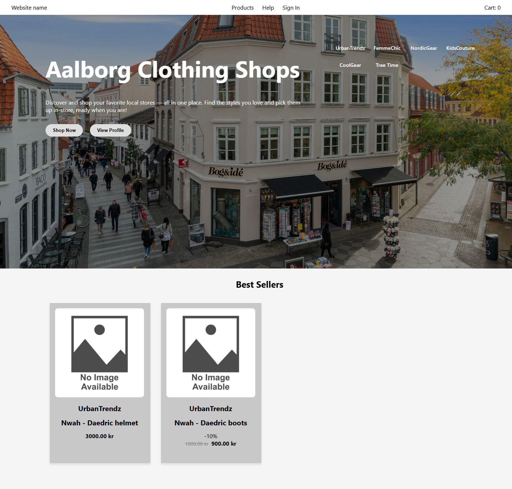

### Product catalogue
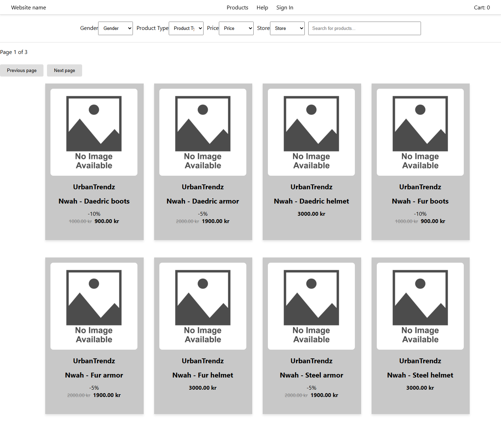

### Product page
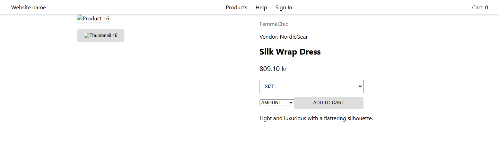

### Cart
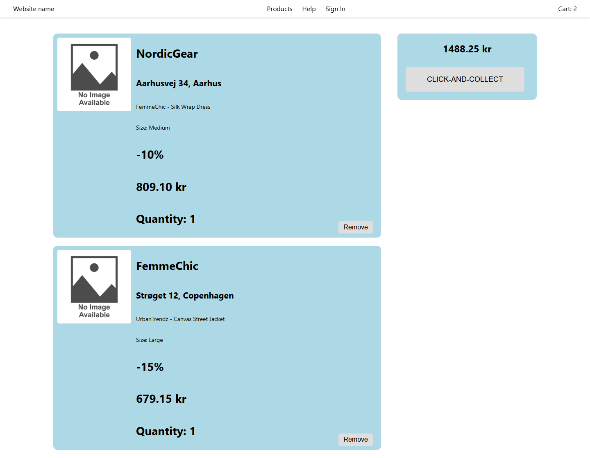

### Sign in
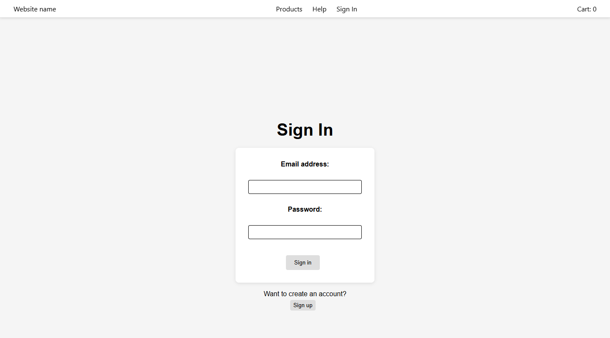

### Profile
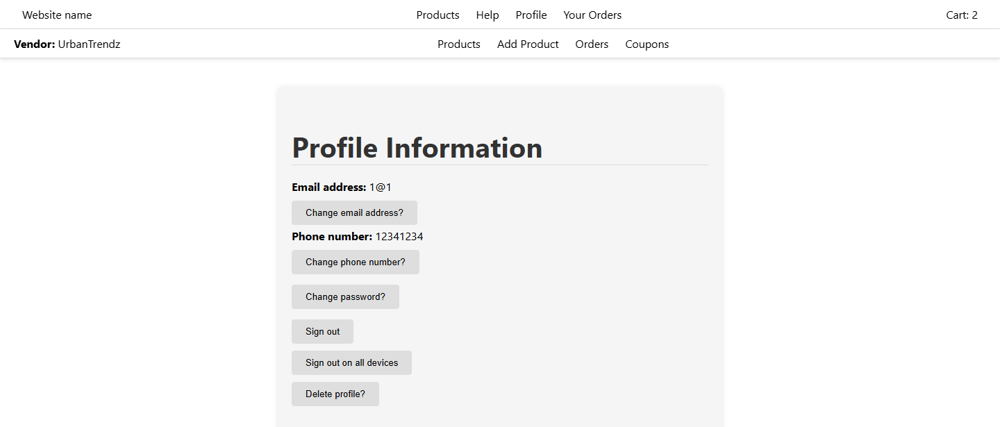

### Order history
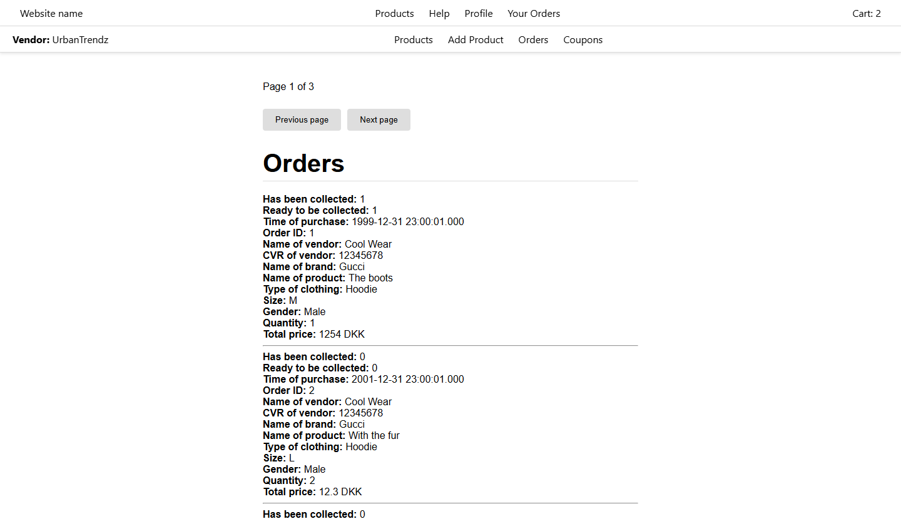

### Help and FAQ
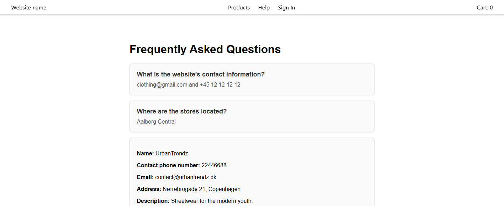

### Vendor: products
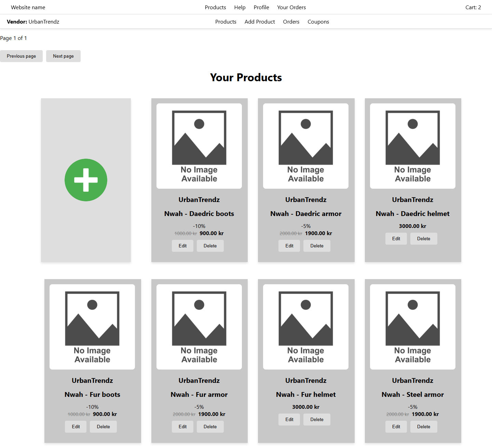

### Vendor: add product
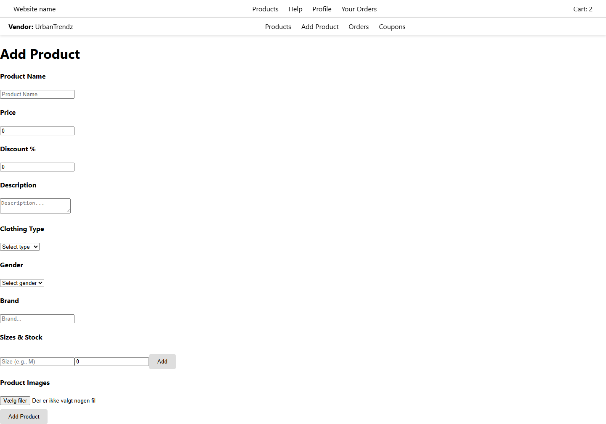

### Vendor: orders
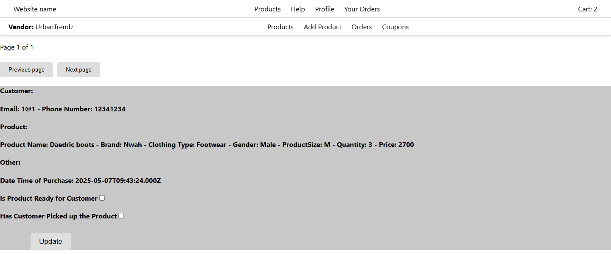

### Vendor: coupons
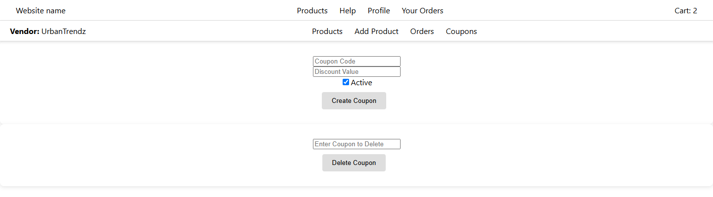

## Tech stack

| Part | Technology |
| --- | --- |
| Frontend | React 19, React Router, Create React App |
| Backend | Node.js, Express, Multer (image uploads) |
| Database | MySQL (via mysql2) |
| Payments | Stripe Checkout |
| Email | EmailJS |
| Tests | Vitest, React Testing Library, Supertest |

## Project structure

```
backend/
  server.js          Starts the API on port 3001
  app.js             Express setup and route registration
  db.js              MySQL connection settings
  routes/            API endpoints (products, profile, vendor, orders, payment, coupons ...)
  utils/             Input validation
  endToEndTests/     End-to-end tests
frontend/
  src/pages/         One folder per page (FrontPage, ProductCatalogue, Cart, Profile, Vendor ...)
  src/utils/         Shared helpers (cookies, cart count, pagination)
docs/screenshots/    Images used in this README
```

## Getting started

### Requirements
- Node.js
- MySQL Server 8 with a database called `P2`

The backend connects to MySQL on `localhost` with the user `root` and the password `password`. If your local setup is different, change the values in `backend/db.js`.

### Install packages

`node_modules` is not included in the repository, so both folders need their packages installed the first time:

```
cd frontend
npm install
```

```
cd backend
npm install
```

### How to start the servers on your own PC

For frontend:
1) Create a new terminal inside the project root folder.
2) Enter "cd frontend".
3) Enter "npm start".

For backend:
1) Create a new terminal inside the project root folder.
2) Enter "cd backend".
3) Enter either "node --watch server.js" or "node server.js".

The website then runs on http://localhost:3000 and the API on http://localhost:3001.

On Windows you can also double-click `startServers.bat` in the project root, which opens both servers in separate terminals. `startFrontendServer.bat` and `startBackendServer.bat` start them one at a time.

For MySQL (only relevant if you have disabled starting it on system boot-up):
1) In Windows Search, search for "services" (Danish: "tjenester").
2) Open the "services" app.
3) Find the service "MySQL80".
4) Right-click it and press "start".
5) You can now connect to your MySQL database using the MySQL Workbench app.

### How to run the tests
* For frontend, navigate to the frontend directory ("cd frontend") and then run "npm run test".
* For backend, navigate to the backend directory ("cd backend") and then run "npm run test".

You can also use `runTests.bat` to run both, or `runFrontendTests.bat` and `runBackendTests.bat` to run them separately.

## Packages

Backend dependencies include bcrypt, jsonwebtoken, node-schedule, cookie-parser, express-validator, cors, multer, mysql2 and stripe. Vitest and Supertest are installed as dev dependencies, which means they are only used during development and testing, not in production.

All of them are listed in `backend/package.json` and `frontend/package.json` and are installed with `npm install`.

How to navigate inside the terminal:
* "cd " + the name of the folder you wish to navigate to.

## FAQ

* If you get an error saying that running scripts is disabled on the system, enter the command "Set-ExecutionPolicy RemoteSigned -Scope CurrentUser" and try running "npm install" again.
* If the backend crashes with "Cannot find module", run "npm install" inside the backend folder.
* If products or stores do not show up, check that MySQL is running and that the `P2` database exists.
